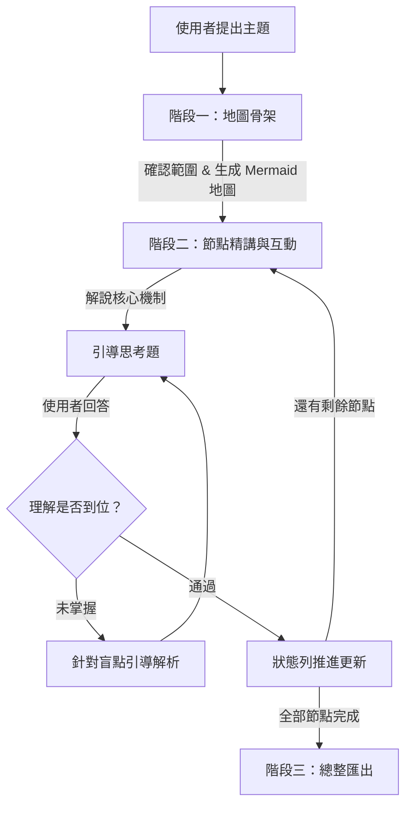
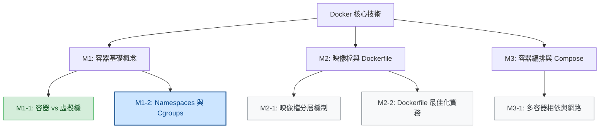

# 🗺️ 知識地圖主題學習法 (Knowledge Map Learning)

> 以「由上而下（Top-Down）」的方式，引導 AI 系統化帶領你掌握任何全新知識領域。

[](https://github.com/Lin-Yu-kuan/mySkill)
[]()

---

## 💡 為什麼需要這個 Skill？

許多人在請 AI 解釋或教學一個陌生領域時，常遇到以下痛點：
- **迷失在細節中**：AI 一開口就丟出一大堆專有名詞與底層細節，缺乏全貌。
- **單向灌輸，吸收不良**：像在讀百科全書，沒有互動思考與理解驗證。
- **缺乏進度感**：聊到一半不知道學到哪裡、還有多少沒掌握。

**Knowledge Map Learning** 解決了這個問題：它讓 AI 化身為結構嚴謹、循序漸進的家教，**先給你整張地圖（見森林），再帶你走過每個地標（見樹木）**。

---

## ✨ 核心特色

1. **先見森林，再見樹木**：一開始先生成 Mermaid 知識地圖骨架與明確的節點編號（如 `M1-1`、`M2-3`）。
2. **抗認知負荷，一次一節點**：拆成認知負荷適中的節點，不一次灌輸整篇長文。
3. **蘇格拉底式引導**：解說核心機制後附思考題，出題後停住等待，確認理解後才推進下一個節點。
4. **狀態即時追蹤**：每回合對話開頭明確輸出進度狀態（如 `> 進度 3/10｜當前 M1-3｜待複習：無`）。
5. **完整總整匯出**：全數完成後，可一鍵彙整為完整複習筆記與題庫。

---

## 🔄 三階段學習流程



### 1. 階段一：地圖骨架
- 評估主題範圍，過大時主動引導收斂。
- 繪製具體且層次分明的 Mermaid 知識地圖，標註節點編號與起始狀態。

### 2. 階段二：逐節點精講與雙向互動
- **狀態列**：每回合開頭顯示當前進度與待複習清單。
- **精準解說**：包含直覺核心、底層機制、實務案例或常見誤區。
- **思考驗證**：出題後**停住等待**，確認理解後才推進下一節點。

### 3. 階段三：總整匯出（可選）
- 輸出整合學習筆記、自我檢驗題庫（附參考解答與難度分級）及後續延伸資源。

---

## 📊 知識地圖渲染效果範例

AI 在第一階段會自動為你繪製類似下方的互動地圖：



---

## 🎮 常用互動指令表

在對話過程中，你可以隨時輸入以下指令來控制學習節奏：

| 指令 | 說明 |
|---|---|
| `地圖` | 重新印出目前完整知識地圖與最新節點狀態清單 |
| `下一節點` 或 `繼續` | 進入下一個未完成節點 |
| `複習 M1-2` | 針對指定節點重新解說核心重點並給出新測驗 |
| `跳過` | 將當前節點標記為「待補」，直接前往下一節點 |
| `測驗` | 針對當前節點再出一題變體挑戰題 |
| `一次全部給我` | 適合已有經驗者，略過互動問答，一次性印出所有節點筆記 |

---

## 📥 安裝與啟用

### 在 Google Antigravity 中使用

#### 方法 1：安裝為全域技能（推薦）
將此 `knowledge-map-learning` 資料夾複製到全域技能目錄：
```powershell
# Windows
Copy-Item -Path "knowledge-map-learning" -Destination "$HOME\.gemini\config\skills\knowledge-map-learning" -Recurse
```

#### 方法 2：在單一專案中使用
將此資料夾複製到你專案目錄的 `.gemini\skills\` 下：
```powershell
Copy-Item -Path "knowledge-map-learning" -Destination "<你的專案路徑>\.gemini\skills\knowledge-map-learning" -Recurse
```

---

## 💬 如何觸發使用？

安裝完成後，在聊天對話中直接對 AI 說：
* *「我想系統化學習 Kubernetes，請帶我走一遍知識地圖學習流程。」*
* *「用 top-down learning 的方式教我 React 狀態管理機制。」*
* *「我想理解分散式系統架構，請幫我規劃學習 roadmap 並逐步教學。」*

---

## 🚫 不適用情境
* 單純名詞查閱（例：「什麼是閉包？」）
* 尋求一問一答的即時解答
* 直接索取程式碼片段
